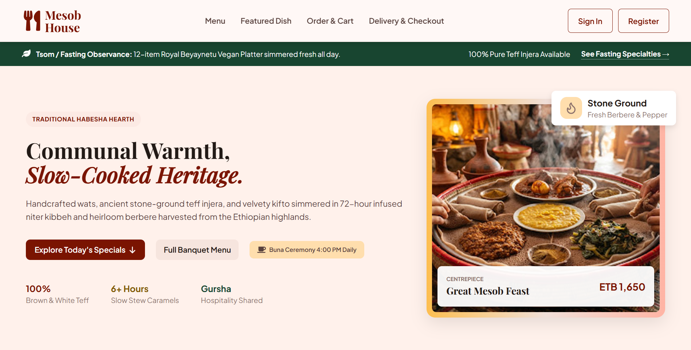
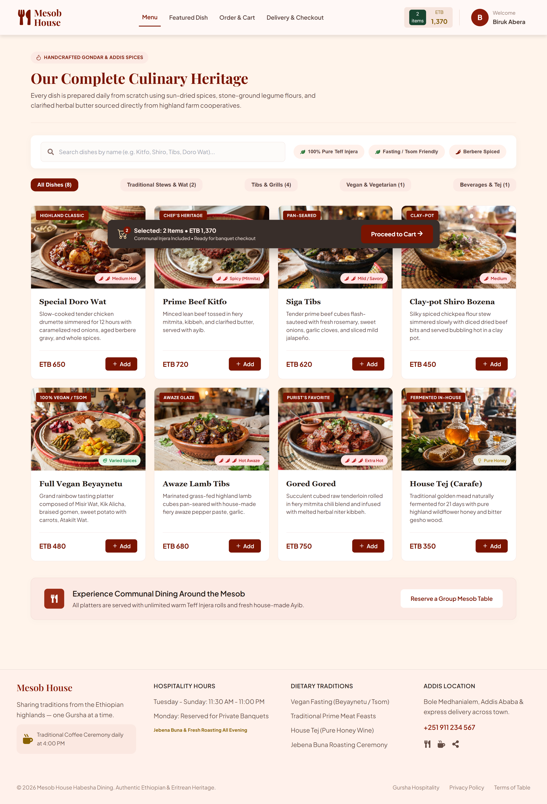
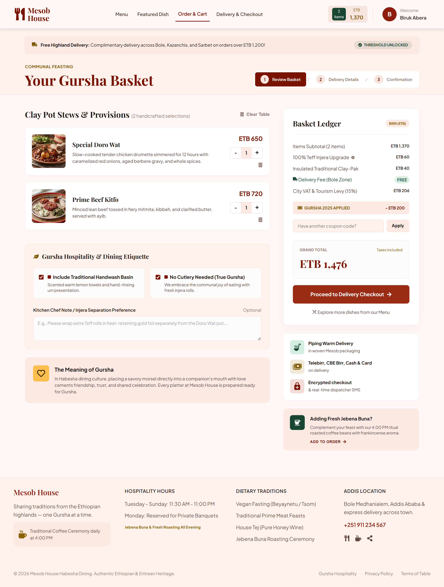
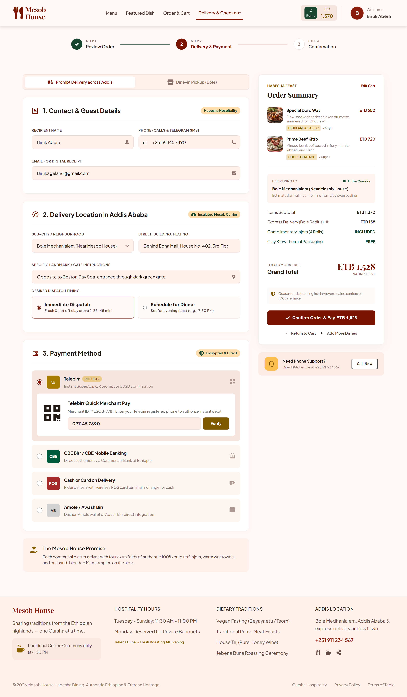
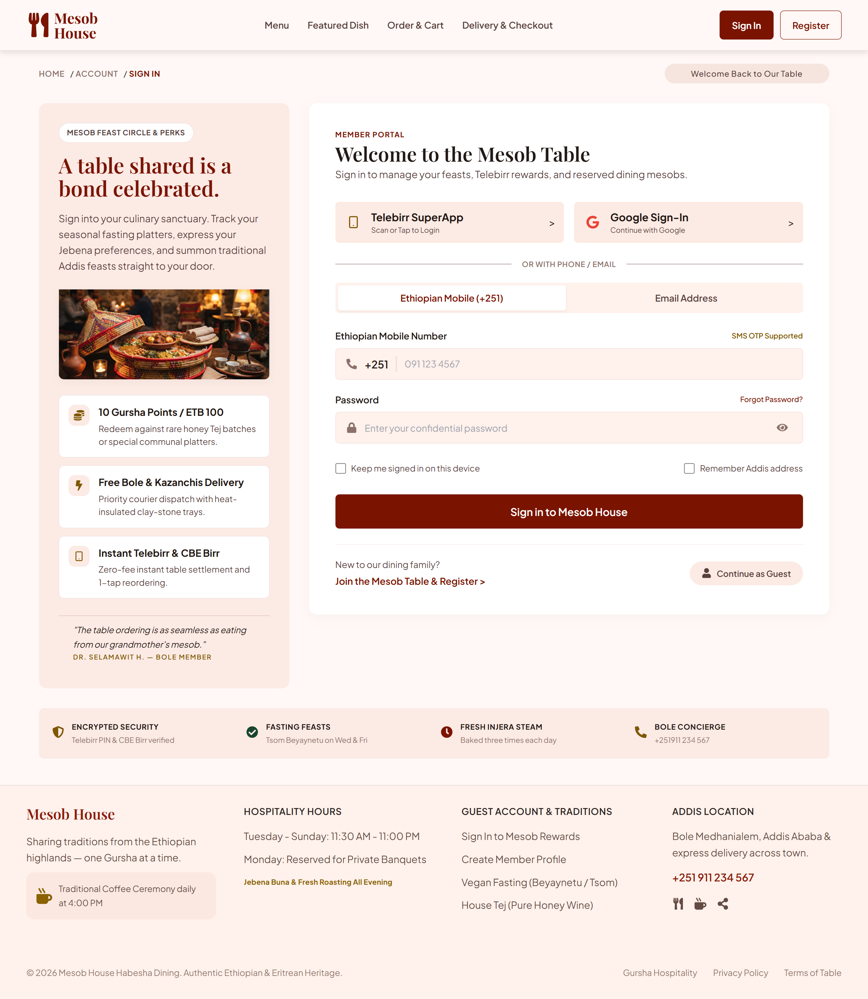
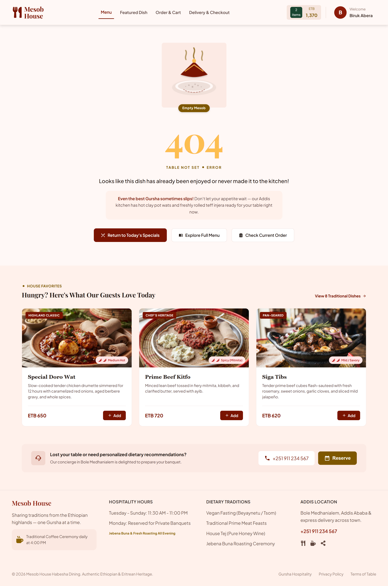

# Mesob House — Ethiopian Restaurant Ordering App

A modern, fully responsive single-page application for a fictional Ethiopian restaurant called **Mesob House**. Built with React 18, React Router v6, and Context API to simulate a real-world food ordering experience — from browsing a fetched menu to a validated multi-step checkout.



---

## 🔗 Live Demo

> **Soon** — Will be deployed to Vercel

---

## ✨ Features

### 🏠 Home Page

- Animated hero with floating badge and stats
- "Today's Curated Chef Specials" — featured dishes fetched from a simulated API
- "The Spirit of Gursha" — Ethiopian cultural tradition section
- Honored Guest Reflections (testimonials)
- Call-to-action banner

### 📖 Full Menu

- Complete menu with **category filtering stored in the URL** (`?category=Tibs`)
- **Real-time search** with debounced filtering
- Dietary feature toggles (Pure Teff, Fasting, Berbere Spiced)
- **Loading, error, and empty states** — all three covered
- Sticky "Selected Items" bar with running total

### 🍽️ Dish Detail

- Individual dish page fetched by ID (`/menu/:id`)
- Loading spinner while fetching
- Graceful fallback to the custom 404 page for invalid IDs

### 🛒 Cart

- Full cart with item images, tags, and quantity controls
- **Real-time pricing** with subtotal, VAT, and grand total
- Persists across page refreshes via `localStorage`
- Quantity controls with **auto-remove when qty drops to zero**
- Gursha Hospitality & Dining Etiquette options
- Chef's Note textarea
- Coupon code input
- Buna (coffee) upsell

### 💳 Checkout

- 3-step progress stepper
- Delivery mode toggle (Delivery / Pickup)
- **Real form validation** — inline errors on name, phone, email, street, and landmark
- Desired dispatch timing (Immediate / Scheduled)
- **4 payment methods** — Telebirr, CBE Birr, Cash on Delivery, Amole
- Order Summary sidebar with live updates
- Submitting state with toast feedback on success

### 🔐 Authentication

- Register page with password confirmation
- Login page with toggle between Ethiopian Mobile (+251) and Email
- **State passing** — email pre-filled on Login after Register
- **Route guards** protecting `/checkout` (guests allowed) and `/account` (guests blocked)
- **Continue as Guest** option
- Persists across refreshes via `localStorage`
- **Logout clears cart** to prevent cross-user leakage

### 👤 Account

- Nested routes: `/account/profile`
- Profile settings with read-only fields
- Sign out with cart cleanup

### 🚫 Custom 404 Page

- Hand-drawn "Empty Mesob" SVG illustration
- Large gold "404" typography
- Vertical "TABLE NOT SET" letter tiles
- Three action buttons (Home, Menu, Cart)
- "House Favorites" section with **real dishes fetched from the menu data**
- Concierge banner with direct phone contact

### 🎨 Design System

- **Consistent color palette** — Deep red (`#7A1401`), gold (`#7E5700`), dark green (`#184530`), warm cream backgrounds
- **Typography hierarchy** — Playfair Display (serif) for headings, Plus Jakarta Sans for body
- **Fully responsive** — Optimized for mobile, tablet, and desktop
- **Zebra section backgrounds** — Alternating cream tones for visual rhythm

---

## 🛠️ Tech Stack

| Category             | Technology                                                                  |
| :------------------- | :-------------------------------------------------------------------------- |
| **Framework**        | React 18                                                                    |
| **Routing**          | React Router v6 (dynamic routes, state passing, wildcard 404, route guards) |
| **State Management** | Context API (`AuthContext`, `CartContext`)                                  |
| **Styling**          | Pure CSS with CSS Variables (one CSS file per page/component)               |
| **Icons**            | React Icons (Font Awesome, Lucide, Game Icons)                              |
| **Build Tool**       | Vite                                                                        |
| **Fonts**            | Google Fonts (Playfair Display, Plus Jakarta Sans)                          |
| **Persistence**      | `localStorage` for cart and auth session                                    |

---

## 📁 Project Structure

src/
├── Assets/ # Images and static files
│
├── api/ # Simulated API layer
│ └── dishes.js # Fetch helpers for dishes and categories
│
├── auth/ # Route protection
│ └── RequireAuth.jsx # Guard component
│
├── components/ # Reusable components
│ ├── Navbar.jsx
│ ├── Footer.jsx
│ ├── MenuItem.jsx
│ ├── Loader.jsx
│ ├── Toast.jsx
│ ├── ErrorBoundary.jsx
│ └── ScrollToTop.jsx
│
├── context/ # Global state
│ ├── AuthContext.jsx
│ └── CartContext.jsx
│
├── data/ # Static data
│ └── menuData.js
│
├── hooks/ # Custom React hooks
│ ├── useFetch.js # Data fetching with loading/error states
│ └── useDebounce.js # Debounced search input
│
├── pages/ # Route pages
│ ├── Home.jsx
│ ├── FullMenu.jsx
│ ├── RoyalDoroWat.jsx # Dish detail page
│ ├── Cart.jsx
│ ├── Checkout.jsx # Lazy-loaded
│ ├── Login.jsx
│ ├── Register.jsx
│ ├── Account.jsx
│ └── NotFound.jsx
│
├── App.jsx # Routes + Providers
├── main.jsx # Entry point
└── index.css # Global styles

---

## 🚀 Getting Started

### Prerequisites

- **Node.js** v18+ installed
- **npm** or **yarn**

### Installation

1. **Clone the repository**

   ```bash
   git clone https://github.com/Biruk-ete/mesob-house.git
   cd mesob-house
   ```

2. **Install dependencies**

   ```bash
   npm install
   ```

3. **Start the development server**

   ```bash
   npm run dev
   ```

4. **Open your browser**
   ```
   http://localhost:5173
   ```

### Build for Production

```bash
npm run build
```

The production-ready files will be in the `dist/` folder, ready to deploy to Vercel, Netlify, or any static host.

---

## 🔄 Application Flow

┌──────────────┐
│ Home (/) │
└──────┬───────┘
│
├───► /menu ─────► /menu/:id ─────► /cart ─────► /checkout
│
├───► /login ─────► /register
│
├───► /account ─────► /account/profile (guarded)
│
└───► \* (any bad URL) ─────► 404 Not Found


---

## 🧠 Key Technical Highlights

### 1. Global State with Context API

Auth and cart state are managed globally — no prop drilling. Any component can call `useAuth()` or `useCart()` and re-render automatically when the state changes.

### 2. Custom Hooks

- **`useFetch`** — Wraps the fetch → loading → error → data lifecycle with cleanup on unmount
- **`useDebounce`** — Delays the search filter to avoid unnecessary re-renders

### 3. Route Guards

A `<RequireAuth>` wrapper checks if the user is logged in. If not, they're redirected to `/login` — and after logging in, they return to wherever they were trying to go.

### 4. Persistence

Both `AuthContext` and `CartContext` sync to `localStorage`, so refreshing the page preserves:

- Logged-in user
- Cart items

Logout clears the cart to prevent cross-user leakage.

### 5. Form Validation

The Checkout page validates:

- Name (required, min length)
- Phone (Ethiopian format regex)
- Email (regex)
- Street address (required)
- Landmark (required)

Errors appear inline and block submission.

### 6. Error Boundary

A class component wraps the entire router. Any render error in a page is caught and shows a friendly fallback — the app never goes fully blank.

### 7. Lazy Loading

The Checkout page is loaded via `React.lazy()` + `<Suspense>` so it doesn't slow down the initial page load.

---

## Screenshots

### Home Page


### Menu Page



### Cart



### Checkout



### Login



### 404 Page



---

## 🔮 Future Improvements

- [ ] **Backend integration** — Firebase or Supabase for real auth and order storage
- [ ] **Real payment integration** — Stripe or Telebirr sandbox
- [ ] **Unit tests** — Jest + React Testing Library on `useFetch`, validation, cart logic
- [ ] **Framer Motion transitions** — Page fade-ins between routes
- [ ] **Dark mode** — Toggle in the Navbar
- [ ] **Accessibility audit** — WCAG AA compliance
- [ ] **Order tracking** — Live status updates
- [ ] **Search autocomplete** — Suggest dishes as users type
- [ ] **Multi-language** — English + Amharic

---

## 👤 Author

**Biruk Abera**

- GitHub: [@Biruk-ete](https://github.com/Biruk-ete)
- LinkedIn: [Biruk Abera](www.linkedin.com/in/birukabera)
- Email: Birukagelan6@gmail.com
